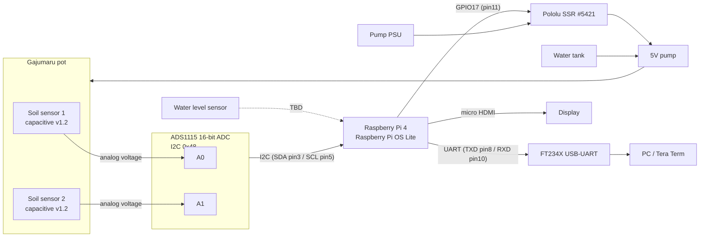
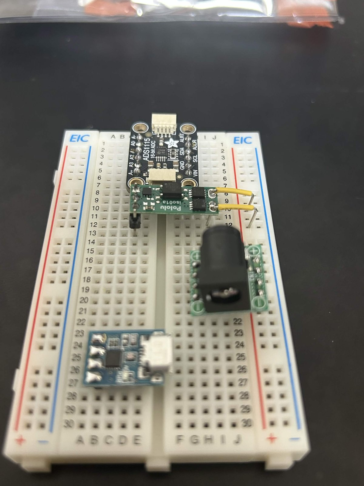

# kijimuna prototype (Raspberry Pi OS + Python)

Linux/Python prototype of the self-watering Gajumaru. It is used to find the
moisture thresholds and pump flow rate, and serves as the stable exhibit build
while the bare-metal kernel (`../kernel`) is developed.

## Hardware overview



### How a moisture reading reaches the CPU

1. The soil sensor turns soil moisture into a 0-3.3 V analog voltage
   (drier = higher voltage).
2. The ADS1115 converts that voltage into a 16-bit signed integer, on request.
3. The Pi talks to the ADS1115 over I2C: it writes the Config register (0x01)
   to start a single-shot conversion on a channel, waits for the OS bit, then
   reads the Conversion register (0x00).
4. On Linux, `smbus2` issues `ioctl()` calls on `/dev/i2c-1`; the kernel's
   `i2c-dev` and `i2c-bcm2835` drivers drive the BSC1 controller.

### Pin map

| Device | Device pin | Pi pin | Notes |
|---|---|---|---|
| ADS1115 | VDD | pin 1 (3.3V) | |
| ADS1115 | GND | pin 6 (GND) | |
| ADS1115 | SDA | pin 3 (GPIO2 / SDA1) | I2C bus 1 |
| ADS1115 | SCL | pin 5 (GPIO3 / SCL1) | |
| ADS1115 | ADDR | GND | address 0x48 |
| Soil sensor 1 | AOUT | ADS1115 A0 | powered from 3.3V (unverified, see below) |
| Soil sensor 2 | AOUT | ADS1115 A1 | powered from 3.3V (unverified, see below) |
| SSR (Pololu #5421) | EN | pin 11 (GPIO17) | HIGH = pump on |
| FT234X | RxD | pin 8 (GPIO14 / TXD) | serial console |
| FT234X | TxD | pin 10 (GPIO15 / RXD) | |
| FT234X | GND | GND | |

Detailed breadboard layout: <https://claude.ai/artifact/AhdYj69hf2qNPciS2BApxN>

### Breadboard



Parts placement as of 2026-11-01, before the jumper wires to the Pi were added.
From top: ADS1115, Pololu iso01a SSR, DC jack (pump power), FT234X USB-UART.

### Open items

- [ ] Confirm which soil sensor is wired to A0 and which to A1.
- [ ] Decide the water level sensor type (digital float switch vs. analog) and its pin.
- [ ] Identify the extra devices at 0x77 / 0x78 seen in `i2cdetect -y 1`.
- [ ] Calibrate dry (air) / wet (water) voltages per sensor.

## Code layout

```
prototype/
├── index.py                      # app: config + main loop
├── hardware_modules/
│   ├── i2c_bus.py                # SMBus, or FakeSMBus when FAKE_I2C is set
│   ├── ads1115_registers.py      # ADS1115 register map + register read/write
│   └── ads1115.py                # init + single-shot voltage read
└── tests/
    ├── conftest.py               # ScriptedBus test double
    ├── test_ads1115_registers.py
    ├── test_ads1115.py
    └── test_i2c_bus.py
```

Dependencies flow one way: `index.py` → `ads1115.py` → `ads1115_registers.py` → bus.
Hardware modules receive the bus as an argument, so tests can pass a fake.

## Running

Requires [uv](https://docs.astral.sh/uv/). Python 3.13 (matches Raspberry Pi OS Trixie).

### On the development machine (no I2C hardware)

```bash
cd prototype
FAKE_I2C=1 uv run python index.py
```

### Tests

```bash
cd prototype
uv run pytest
```

Tests use `ScriptedBus` (`tests/conftest.py`), which records writes and returns
scripted register values, so ADS1115 behavior such as the OS bit staying 0
during a conversion can be simulated without hardware.

### On the Raspberry Pi

```bash
# from the development machine
rsync -av --exclude .venv --exclude __pycache__ prototype/ abirushouta@<pi-ip>:~/prototype/

# on the Pi
cd ~/prototype
uv sync --no-dev
uv run python index.py
```

The user needs to be in the `i2c` and `gpio` groups (default on Raspberry Pi OS).
If building `lgpio` fails, install `swig` and `liblgpio-dev` with apt.

## References

- ADS1115 datasheet: <https://www.ti.com/lit/ds/symlink/ads1115.pdf>
- smbus2: <https://smbus2.readthedocs.io/>
- gpiozero: <https://gpiozero.readthedocs.io/>
- Raspberry Pi GPIO pinout: <https://www.raspberrypi.com/documentation/computers/raspberry-pi.html>
